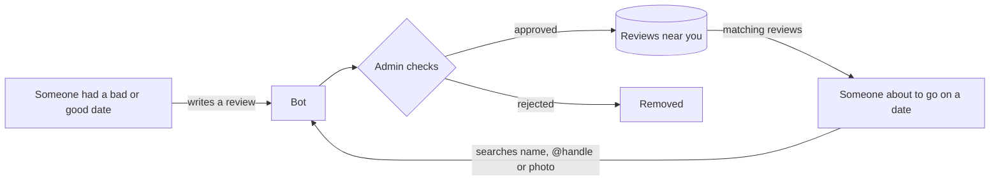

# Dating Popcorn Bot

A Telegram bot that allows users to review their dating partners and protect others by sharing experiences.

> Built as a freelance project. The client has allowed me to make it public.

## 💡 The Idea

People share their dating experiences, so others can check a person before meeting them.



## Features

- **Write Reviews**: Share experiences about dating partners
- **Search Reviews**: Find reviews by name/identifier or by photo (local face recognition, no AWS)
- **Location-based**: Shows reviews from people close to your location
- **Multilingual**: Supports English and Spanish with YAML-based localization
- **Image Support**: Upload photos with reviews or search by image
- **Proper Architecture**: Clean folder structure with separation of concerns

## Tech Stack

- **Python 3.11** (Required)
- aiogram 3.2.0 (Telegram Bot Framework)
- PyYAML 6.0.1 (Localization)
- PostgreSQL + PostGIS (location) + pgvector (face search)
- OpenCV YuNet + SFace (small ONNX face models, run locally)
- Docker & Docker Compose
- Memory storage (for MVP)

## Project Structure

```
Dating-Popcorn-Bot/
├── src/                          # Source code
│   ├── bot/                      # Bot implementation
│   │   ├── __init__.py
│   │   ├── bot.py               # Main bot runner
│   │   └── handlers.py          # Message and callback handlers
│   ├── models/                   # Data models
│   │   ├── __init__.py
│   │   ├── user.py              # User and location models
│   │   └── review.py            # Review and search models
│   └── utils/                    # Utilities
│       ├── __init__.py
│       └── localization.py      # YAML-based localization
├── locales/                      # Localization files
│   ├── en/                      # English translations
│   │   └── messages.yaml
│   └── es/                      # Spanish translations
│       └── messages.yaml
├── config/                       # Configuration
│   ├── __init__.py
│   └── settings.py              # App settings and environment
├── main.py                      # Entry point
├── requirements.txt             # Python dependencies
├── Dockerfile                   # Container configuration
├── docker-compose.yml          # Docker deployment
├── example.env                 # Environment template
└── README.md                   # This file
```

## Localization

The bot uses YAML files for localization with a hierarchical structure and variable support:

Translations live in `locales/en/messages.yaml` (English) and `locales/es/messages.yaml` (Spanish).

```python
# Get message with hierarchical key
message = get_message(user_language, 'bot.welcome.message')

# Get message with formatting and variables
message = get_message(user_language, 'review.flow.enter_text', name="John")

# Variables are automatically substituted from common.variables
# {bot_name} becomes "Dating Popcorn"
# {max_review_length} becomes "2000"
```

## 🐳 Local Development

### Prerequisites
- **Python 3.11** (Required)
- Docker & Docker Compose
- Telegram Bot Token

### Quick Start

1. **Get your bot token** from [@BotFather](https://t.me/botfather)
2. **Create `.env` file**:
   ```bash
   BOT_TOKEN=your_telegram_bot_token_here
   ```
3. **Run with Docker (production-like)**:
   ```bash
   docker compose build
   docker compose up -d postgres dating-bot dating-api
   ```

4. **Run with Docker (development, hot reload)**:
   - Bot (watch files, no rebuild on code changes):
     ```bash
     docker compose --profile dev up -d postgres dating-bot-dev
     ```
   - API (uvicorn --reload):
     ```bash
     docker compose --profile dev up -d postgres dating-api-dev
     ```

### Docker Commands
```bash
# View logs
docker compose logs -f

# Stop the bot
docker compose down

# Restart the bot
docker compose restart
```

## Bot Commands

- `/start` - Start the bot and share location
- `/search` - Search for reviews
- `/write` - Write a new review

## Bot Flow

### Getting Started
1. User starts the bot with `/start`
2. User shares their location
3. User chooses to write a review or search for reviews

### Writing a Review
1. Enter the person's full name
2. Optionally provide exact identifier (phone or @handle)
3. Write the review text
4. Optionally upload a photo

### Searching Reviews
1. Choose search method:
   - Search by name/identifier (phone or @handle)
   - Search by image upload
2. Enter search criteria
3. View results sorted by distance and relevance

Search rules:
- Name search requires at least 2 words (e.g. "Max Hermes"). Single-word queries return no results.
- Name search is typo-tolerant (PostgreSQL `pg_trgm`): "Mario Gonzales" finds "Maria Gonzalez", "Max Hermez" finds "Max Hermes". Very short names with a one-letter change (e.g. "Maks" vs "Max") are intentionally not matched, to avoid showing reviews of the wrong person. Every query word must closely match a word in the name; tune with `FUZZY_NAME_THRESHOLD` in `src/database/services.py`.
- Identifier search (phone or handle) is exact match on the stored identifier:
  - `@` prefix is optional when searching; `robert_88` is treated as `@robert_88`.
  - Partial matches do not return results (e.g. `act111` won’t match `exact111`).
- Exact identifiers are used internally for matching but are not displayed in results.

Photo search:
- The bot finds the largest face in the photo and turns it into a 128-number vector. Review photos are indexed the same way when the review is saved.
- Matching uses cosine similarity (threshold 0.363) among approved reviews within the search radius, top 3 shown.
- A photo with no clear face (or a face smaller than 80px) is rejected. A review photo without a usable face still saves but can't be found by photo.
- Models (~40 MB) download on first use. Index photos that existed before this feature with `python -m scripts.backfill_face_embeddings`.

## Language Support

The bot supports:
- English (default)
- Spanish

Users can change language using the language button in the main menu.

Search result messages:
- English: "No results found."
- Spanish: "No se encontraron resultados."

## Development

### Adding New Languages

1. Create new folder in `locales/` (e.g., `locales/fr/`)
2. Create `messages.yaml` file with translations
3. Add language code to `SUPPORTED_LANGUAGES` in `config/settings.py`
4. Update language selection keyboard in `src/bot/handlers.py`

### Adding New Message Keys

1. Add key to all language files in `locales/*/messages.yaml`
2. Use the key in your code with `get_message(language, 'your_key')`

### Project Architecture

- **`src/bot/`**: Bot implementation and handlers
- **`src/models/`**: Data models and structures
- **`src/utils/`**: Utility functions and helpers
  - `review_display.py`: Formats and sends results; exact identifiers are intentionally hidden from output
- **`locales/`**: YAML-based localization files
- **`config/`**: Configuration and settings

## License

